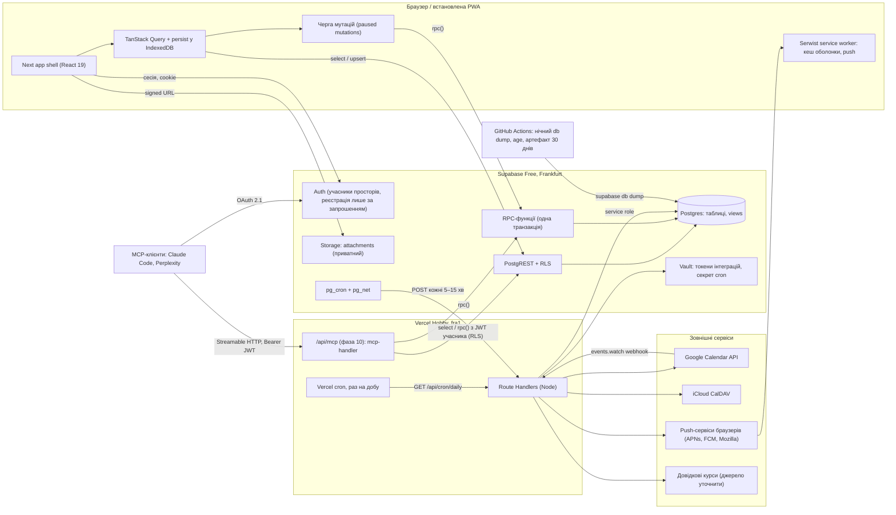
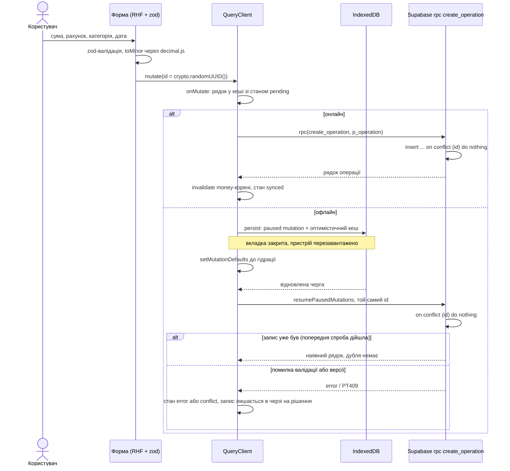
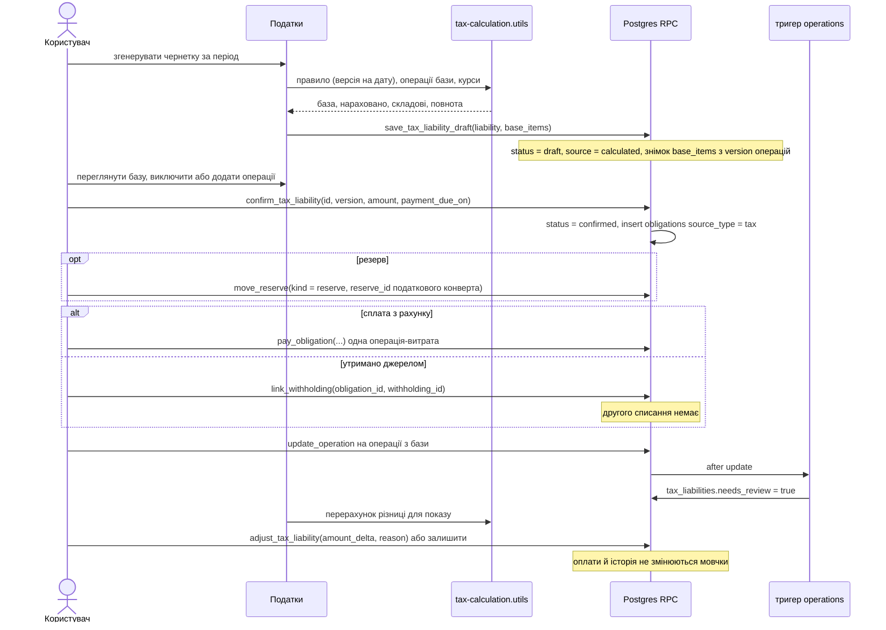
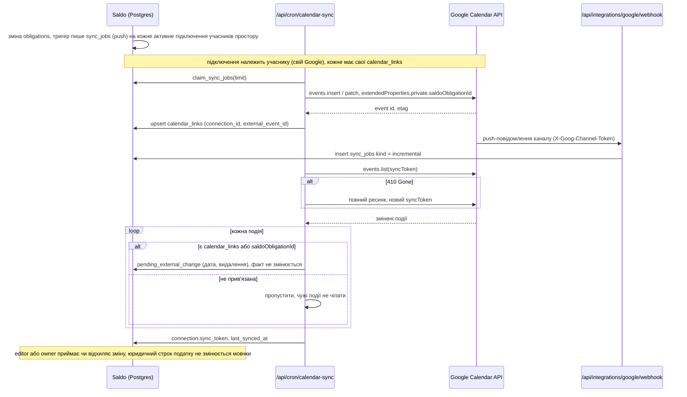
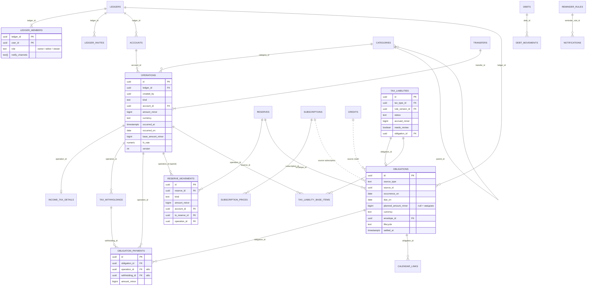
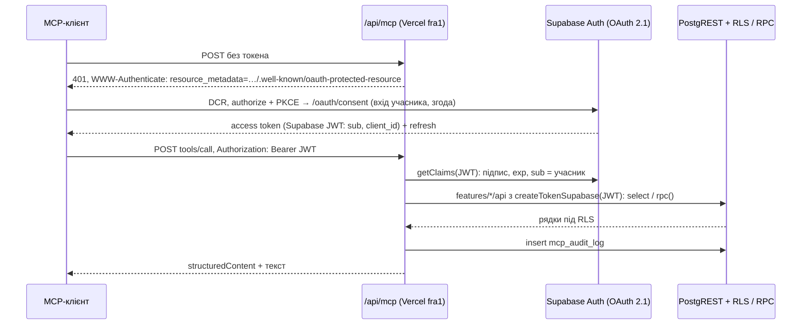

# Saldo: архітектура

Версія 1.1 · 30.10.2026 · відповідає специфікації v1.1 (`docs/spec/specification-v1.1.txt`, далі §N) з одним
розширенням: спільний доступ до простору (ADR 19, рішення Максима від 30.10.2026).
Дослідження, на яких стоять рішення: `docs/research/platform.md`, `nextjs-patterns.md`, `libraries.md`, `sharing.md`, `mcp.md`.
План робіт — `docs/plan.md`, стек — `docs/stack.md`, правила коду — `docs/conventions.md`.

## 1. Контекст і межі

- Кілька користувачів (спершу двоє: Максим і близька людина), кожен на кількох пристроях: desktop, tablet,
  mobile, встановлена PWA (§1, §22). У кожного свій **простір** (ledger) з усіма даними, приватний за
  замовчуванням; власник може розшарити простір іншій людині з роллю editor або viewer (ADR 19).
- Мета: поточні кошти, витрати, майбутні зобов'язання й доступний залишок, кожна цифра з поясненням (§1, §3).
- Поза межами (§1): робочі проєкти, таймтрекінг, інвестиції, сценарії «а якщо», гарантії, аудит виписок,
  подання декларацій, сплата податків, юридичні поради. «Сімейний доступ» §1 відніс за межі — Максим погодив його
  30.10.2026 у вигляді шарингу цілого простору (ADR 19); шаринг окремих рахунків не робиться.
- Наскрізні інваріанти (§1, §26), які стоять у схемі БД, а не лише в UI:

| Інваріант | Де забезпечено |
|---|---|
| Один факт вводиться один раз | PK `id` = UUID клієнта, `on conflict (id) do nothing`; `fuelings.operation_id unique`, `obligation_payments` unique-пари |
| План окремо від факту | `obligations` і `operations` — різні таблиці; стан «оплачено» лише через `obligation_payments` |
| Календар не підтверджує оплату | вхідні зміни з Google/iCloud лише пропонуються (`calendar_links.pending_external_change`) |
| Переказ не є витратою | `operations.kind in ('transfer_out','transfer_in')` виключені зі статистики витрат |
| Резерв не є витратою | `reserve_movements` — окрема таблиця, не рух коштів |
| Невідоме не вигадується | `planned_amount_minor`, `accrued_minor`, `gross_minor`, `base_amount_minor` — nullable, `check (> 0)` там, де значення є |
| Підсумок пояснюваний | доступні гроші, податки, бюджет рахуються чистими функціями, що повертають складові |
| Простір ізольований | `ledger_id` на кожній доменній таблиці; RLS через членство; складені FK `(ledger_id, <ref>_id)` не дають операції простору A посилатися на рахунок простору B |
| Видно, хто вніс і хто підтвердив | `created_by` на кожному рядку; у `obligation_payments` це «Підтвердив(ла)», у `obligations.settled_by` — хто закрив повністю |

## 2. Рішення (ADR коротко)

| # | Рішення | Причина | Відкинуто |
|---|---|---|---|
| 1 | Хостинг Vercel Hobby, регіон `fra1` | безкоштовно для особистого використання, близько до БД | iad1 за замовчуванням — зайва затримка до Франкфурта |
| 2 | Supabase Free (Frankfurt): Postgres, Auth, Storage, pg_cron, pg_net, Vault | транзакції, CHECK/FK/UNIQUE, RLS, файли без картки | Firebase: транзакції падають офлайн, Storage і Functions лише на Blaze з карткою, немає FK/CHECK/join |
| 3 | Доступ до даних із браузера: supabase-js + RLS + TanStack Query | працює з офлайн-чергою, RLS — справжня межа безпеки | Server Actions для даних: виконуються послідовно, не відтворюються після reload |
| 4 | Кожен запис у кілька таблиць — одна Postgres-функція через `rpc()` | одна транзакція: операція + оплата + резерв не розходяться (§4) | кілька запитів із клієнта — частковий запис офлайн |
| 5 | PK = UUID, згенерований клієнтом, він же ключ ідемпотентності | повтор офлайн-мутації не дає дубля (§22, §26) | окремий `idempotency_keys` — зайва таблиця |
| 6 | Оновлення несуть `version`, невідповідність → конфлікт `PT409` | конфлікти не затираються мовчки (§22) | last-write-wins |
| 7 | Гроші — `bigint` мінорних одиниць + `currency`; конвертація decimal.js з явним округленням | точність (§21) | `numeric` у JS як float; dinero.js — зайва модель |
| 8 | Операція зберігає оригінальну суму, суму в базовій валюті, курс, джерело й дату курсу | історія не переписується новим курсом (§21, §26) | перерахунок історії за поточним курсом |
| 9 | Залишки похідні (views), не збережені лічильники | редагування автоматично узгоджує залишки (§4, §26) | `accounts.balance` з тригерами — розходження при збоях |
| 10 | Одна таблиця `obligations` для всіх планових платежів | календар і «Найближчі» читають ті самі записи (§7, §18) | окремі таблиці платежів на модуль — дублювання логіки оплати |
| 11 | Власний модуль повторень на date-fns + @date-fns/tz; зобов'язання матеріалізуються на ~13 міс. | правила короткого місяця й зміна ціни з дати (§8) | rrule: 3 роки без релізів, не вміє «наступного 1-го» |
| 12 | Податки налаштовувані: профілі, типи, версії правил, знімок бази | юрисдикція не визначена (§14–17, §25) | зашиті ставки ФОП |
| 13 | Нагадування: pg_cron → pg_net → `/api/cron/reminders` → Web Push (@pushforge/builder) | Vercel Hobby cron лише раз на добу | Vercel cron для нагадувань; `web-push` (MPL-2.0, 21 міс. без релізу) |
| 14 | Google Calendar API + iCloud CalDAV, серверно, в останній фазі | двосторонній зв'язок за ID, не за назвою (§19) | ICS-підписка — лише читання, без зв'язків |
| 15 | Офлайн: Serwist (`@serwist/turbopack`) + Query persist у IndexedDB + `resumePausedMutations` | офіційний шлях для Next 16 | next-pwa — не підтримує Turbopack |
| 16 | Файли: приватний бакет Supabase Storage `attachments`, signed URL | 1 ГБ безкоштовно, RLS | Vercel Blob / R2 — запасні |
| 17 | Бекап: GitHub Actions щоночі `supabase db dump`, шифрований артефакт | на Free немає автоматичних бекапів | бекап у git — витік фінансових даних |
| 18 | MCP (фаза 10): remote Streamable HTTP у тому самому Next (`mcp-handler` 2), OAuth 2.1 через Supabase Auth OAuth Server, RLS за токеном учасника | один деплой; Claude Code і Perplexity підтримують OAuth + DCR; tools використовують ті самі схеми, `*.api.ts` і RPC, що й UI (`docs/research/mcp.md`) | stdio — Perplexity лише в Mac App Store; service-role — обхід RLS; Edge Functions — другий рантайм |
| 19 | **Спільний доступ: простори (ledgers) з учасниками й ролями.** Рішення Максима 30.10.2026 («можу розшарити свій з кимось»), розширює §1. У кожного користувача свій простір (створюється тригером при реєстрації), приватний за замовчуванням. Власник (owner) запрошує людину з роллю `editor` (вносить операції, позначає оплати) або `viewer` (лише бачить) і може відкликати доступ. Людина буває в кількох просторах і перемикається між ними. Усі дані, «Доступно», бюджет, нагадування, календарі й податки рахуються в межах одного простору. Межа — RLS: `ledger_id in (select private.my_ledger_ids(…))`, функція `security definer` у схемі `private` (§5.0). Шаринг — з фаз 0–1, не «на потім» | двоє людей ведуть спільний бюджет; приватність = окремий простір, тож не треба прапорця видимості на кожному рядку й окремої логіки «Доступно» для двох; модель YNAB shared budgets | одна «сім'я» з прапорцем `visibility` personal/shared на рахунках: кожна залежна таблиця (операції, оплати, резерви, податки) успадковує видимість — складні політики й «Доступно», що різниться між глядачами; шаринг окремих рахунків; `user_id` + список «друзів» |
| 20 | Запрошення — власна таблиця `ledger_invites` з одноразовим токеном (у БД лише SHA-256), посилання власник пересилає сам (месенджер); прийняття — RPC `accept_ledger_invite` (`security definer`); новий акаунт для запрошеного створює Route Handler через `auth.admin.createUser` лише за дійсним токеном | реєстрацію вимкнено; вбудований SMTP Supabase шле лише на адреси команди організації (з 26.09.2024) і 2 листи/год; не потрібен власний SMTP | `auth.admin.inviteUserByEmail` — потребує custom SMTP, не знає про простір і роль, PKCE не підтримує; відкрита реєстрація |
| 21 | Одночасні правки двох людей: та сама модель, що й між пристроями — UUID клієнта + `version` + `PT409`; `pay_obligation` бере `p_expected_version` зобов'язання й блокує рядок `for update` | дві оплати одного платежу офлайн з різних телефонів інакше дали б подвійну оплату (у кожної свій UUID, тож ідемпотентність не рятує) | last-write-wins; Realtime-блокування |
| 22 | **Репозиторій GitHub публічний** (рішення Максима 30.10.2026). Особисті дані — лише поза git: `.gitignore` ховає `.private/`, `docs/spec/`, `docs/design/screens/`, `.env*` (крім `.env.example`); gitleaks у lefthook + GitHub secret scanning і push protection; workflow з секретами не запускаються з PR (§8) | відкритий код; у специфікації й демо-екранах — реальні доходи й кредити | приватний репозиторій — рішення Максима інше |
| 23 | Нічний бекап шифрується **age** на публічний ключ (recipient); приватний ключ лише в Максима, поза GitHub (§9) | у публічному репозиторії артефакти Actions може завантажити будь-хто з акаунтом GitHub; CI не має чим розшифрувати — витік secrets не відкриває бекапи | `gpg --symmetric` з паролем у secrets (пароль і шифротекст в одному місці); приватне сховище (R2/S3) — ще один акаунт і ключі |
| 24 | Домен `saldo.maksymvasianin.com`: DNS на Cloudflare, CNAME `saldo` → Vercel у режимі **DNS only** (сіра хмара), Vercel-проєкт у `fra1` (§7) | основний сайт уже на Vercel, DNS — на Cloudflare | проксі Cloudflare (помаранчева хмара) — Vercel не видасть сертифікат; `*.vercel.app` — URL зміниться при перейменуванні, OAuth і VAPID прив'язані до домену |

## 3. Діаграми

### 3.1 Компоненти



### 3.2 Додати витрату онлайн і офлайн



### 3.3 Підтвердження оплати зобов'язання

```mermaid
sequenceDiagram
  actor U as Користувач
  participant UI as Найближчі / Календар
  participant Q as QueryClient
  participant PG as rpc pay_obligation
  participant Cron as pg_cron (нагадування)
  participant Sync as calendar sync job

  U->>UI: "Оплачено" на записі
  UI->>U: підтвердити суму, дату, рахунок, резерв
  U->>UI: підтвердити (або вибрати наявну операцію)
  UI->>Q: mutate(payment_id, operation_id = нові UUID, expected_version)
  Q->>PG: pay_obligation(...)
  PG->>PG: begin
  PG->>PG: RLS: роль owner/editor у просторі зобов'язання, інакше 42501
  alt payment_id уже є (повтор тієї ж мутації)
    PG-->>Q: поточний стан, нічого не пишеться
  end
  PG->>PG: select obligations for update; version <> expected → PT409
  Note over PG: друга людина вже позначила оплату → конфлікт із «Підтвердив(ла) …», а не друга оплата
  PG->>PG: insert operations on conflict do nothing (або перевірка наявної)
  PG->>PG: insert obligation_payments on conflict do nothing
  PG->>PG: якщо p_reserve_id: insert reserve_movements kind = spend
  PG->>PG: перевірки: сума оплат за операцією не більша за операцію, резерв не мінус
  PG->>PG: update obligations: version + 1 (settled_by, якщо p_settle)
  PG->>PG: insert sync_jobs на кожне активне календарне підключення учасників простору
  PG->>PG: commit
  PG-->>Q: obligation_states рядок
  Q->>Q: invalidate operations, obligations, reserves, overview
  Cron->>PG: due_reminder_fires(now)
  PG-->>Cron: оплачене зобов'язання не повертається (stop_when_paid)
  Sync->>Sync: подія календаря позначена оплаченою, факт на фактичній даті
```

### 3.4 Доставка нагадування

```mermaid
sequenceDiagram
  participant Cron as pg_cron, кожні 5–15 хв
  participant Net as pg_net
  participant R as /api/cron/reminders (Node)
  participant PG as Postgres (service role)
  participant WP as Push-сервіс
  participant SW as Service worker
  participant NC as Центр сповіщень

  Cron->>Net: net.http_post(url, x-cron-secret з Vault)
  Net->>R: POST
  R->>R: порівняння секрету (timingSafeEqual)
  R->>PG: select * from due_reminder_fires(now())
  PG-->>R: правило, зобов'язання, offset, fire_key, учасник (рядок на кожного учасника простору з увімкненими нагадуваннями)
  R->>PG: insert notifications on conflict (user_id, fire_key) do nothing returning id
  Note over R,PG: повертаються лише нові: повтор крону не дає дубля; кожен учасник отримує своє
  loop кожна нова notification x кожна push_subscription її user_id
    R->>WP: Web Push (VAPID, @pushforge/builder)
    alt 201
      R->>PG: delivery_status = sent
    else 404 або 410
      R->>PG: delete push_subscriptions
    else інша помилка
      R->>PG: delivery_status = failed
    end
  end
  WP->>SW: push
  SW->>SW: showNotification (обов'язково для iOS)
  NC->>PG: select notifications (у застосунку, нові / прочитані)
```

### 3.5 Життєвий цикл податкового зобов'язання



### 3.6 Двостороння синхронізація з Google



### 3.7 ER-діаграма ядра

Кожна сутність нижче має `ledger_id` → `ledgers` (на діаграмі показано лише для рахунків і зобов'язань).



### 3.8 Запрошення в простір

```mermaid
sequenceDiagram
  actor O as Власник
  participant UI as Налаштування → Доступ
  participant PG as Postgres
  actor I as Запрошена людина
  participant P as /invite/[token]
  participant R as /api/invites/accept (Node, service role)

  O->>UI: email, роль editor / viewer
  UI->>UI: token = 32 випадкові байти (crypto), лише в браузері
  UI->>PG: rpc create_ledger_invite(id, ledger_id, email, role, sha256(token))
  PG->>PG: RLS: лише owner; строк 7 днів
  UI-->>O: посилання …/invite/{token}, «Копіювати» (надіслати самому)
  I->>P: відкриває посилання
  alt уже має акаунт
    P->>P: вхід (/login?next=/invite/{token})
    P->>PG: rpc accept_ledger_invite(token)
  else акаунта немає
    P->>R: POST token, пароль
    R->>PG: перевірка: hash є, не прийнято, не прострочено
    R->>R: auth.admin.createUser(email з запрошення, пароль, email_confirm)
    Note over R: тригер on auth.users створює власний простір і user_settings
    R-->>P: вхід signInWithPassword, далі accept_ledger_invite(token)
  end
  PG->>PG: security definer: hash, строк, email = auth.jwt() email; insert ledger_members; accepted_at
  PG-->>P: ledger_id → перемикання на простір
  O->>UI: пізніше «Відкликати» → delete ledger_members, доступ зникає з наступним запитом
```

## 4. Модулі (features)

Кожен модуль — `src/features/<name>/`. Модулі не імпортують один одного (dependency-cruiser); спільне — у
`src/lib`, `src/components`, `src/types`. Композиція — в `src/app` і `src/components/layout`.

| Модуль | Відповідальність | Пише | Читає | § |
|---|---|---|---|---|
| `auth` | вхід/вихід, створення акаунта за запрошенням | Auth | — | §21 |
| `ledgers` | простори: перемикач, «Доступ» (учасники, ролі, запросити, відкликати, вийти), прийняття запрошення, налаштування простору | `ledgers`, `ledger_members`, `ledger_invites` (rpc) | `ledger_members` | ADR 19 |
| `overview` | блоки Огляду, «Доступно», порядок і приховування блоків | `user_settings.overview_layout` | `account_balances`, `reserve_balances`, `obligation_states`, місячні підсумки | §3 |
| `operations` | операції, перекази, повернення, коригування, дублювання, фільтри | `operations`, `transfers`, `income_tax_details`, `tax_withholdings`, `attachments` | `categories`, `accounts`, `fx_rates` | §4, §5, §17 |
| `accounts` | рахунки, архів, картка рахунку | `accounts` | `account_balances`, `obligations`, `reserve_balances` | §5 |
| `categories` | дерево категорій, порядок, архів, перенесення операцій | `categories` (rpc `archive_category`) | — | §6 |
| `currencies` | базова валюта, ручні курси, довідкові курси | `fx_rates`, `ledgers.base_currency` | — | §21 |
| `obligations` | «Найближчі», діалог «Оплачено», прив'язка наявної операції, ручні планові платежі | `obligations`, `obligation_payments` (rpc) | `obligation_states` | §7, §24 |
| `subscriptions` | підписки, ціни з датою чинності, стани, оцінка, два підсумки | `subscriptions`, `subscription_prices`, `obligations` (rpc) | `obligation_states` | §8 |
| `credits` | кредити, графік, дострокове погашення, заміна графіка | `credits`, `obligations` (rpc) | `obligation_states` | §9 |
| `debts` | «Мені винні» / «Я винен», часткові повернення, частка покупки | `debts`, `debt_movements`, `operations` (rpc) | — | §10 |
| `budget` | місяць, ліміти, копіювання, перенесення залишку | `budget_months`, `budget_limits` | `budget_month_facts()` | §11 |
| `reserves` | конверти, цілі, рухи резерву, дефіцит | `reserves`, `reserve_accounts`, `reserve_movements` (rpc) | `reserve_balances`, `account_free_balances` | §12 |
| `big-expenses` | великі витрати, план резервування | `big_expenses`, `obligations` (rpc) | `reserve_balances` | §12 |
| `auto` | авто, заправки, сервіси, план робіт | `vehicles`, `fuelings`, `services`, `service_items`, `maintenance_plans` (rpc з операцією) | — | §13 |
| `taxes` | профілі, типи, версії правил, зобов'язання, база, утримання, коригування | `tax_*` (rpc) | `operations`, `tax_liability_states` | §14–17 |
| `calendar` | місяць / тиждень / день / список, фільтри, збережені набори | `calendar_saved_filters` | `calendar_entries()` | §18 |
| `notifications` | правила нагадувань, центр сповіщень, push-підписка | `reminder_rules`, `notifications.read_at`, `push_subscriptions` | `notifications` | §19 |
| `calendar-sync` | підключення Google/iCloud, міграція наявних серій, розбір вхідних змін | `calendar_connections`, `calendar_links`, `sync_jobs` | `obligations` | §19, §25 |
| `statistics` | звіти з табличним еквівалентом | — | `stats_*()` | §20 |
| `settings` | профіль, часовий пояс, тема, приховування сум, безпека, офлайн | `user_settings` | — | §21 |
| `data-export` | CSV операцій, повний JSON + вкладення, видалення даних | — | усі таблиці | §21 |
| `search` | глобальний пошук ⌘K | — | `search_entities()` | §2 |

Спільні чисті модулі (використовують кілька фіч і cron):

- `src/lib/money/` — `money.utils.ts` (мінорні одиниці, форматування), `fx.utils.ts` (конвертація з курсом).
- `src/lib/recurrence/recurrence.utils.ts` — генерація дат серій, правило короткого місяця, часові пояси.
- `src/lib/finance/available-money.utils.ts` — «Доступно» зі складовими; `reserve-allocation.utils.ts`.
- `src/lib/supabase/` — клієнти (browser, server, admin `.server.ts`), `pg-error.utils.ts`.
- `src/contexts/ledger.context.tsx` — DI активного простору (`ledgerId`, `role`); фічі читають його хуком, а не
  імпортом `ledgers`. Активний простір — cookie `saldo-ledger` + `user_settings.last_ledger_id`.

Крос-модульні дії без імпорту фіч одна в одну: глобальні шторки «Оплачено» і «Додати …» відкриваються
параметром URL (`?pay=<obligationId>`, `?add=expense`, nuqs) і змонтовані в `src/app/(app)/layout.tsx`, який
імпортує `obligations` і `operations`. Будь-яка фіча відкриває їх посиланням, не імпортом.

## 5. Модель даних

Postgres 15+ у схемі `public`. Спільні правила для кожної доменної таблиці (усе, що належить простору):

- `id uuid primary key` — генерує клієнт (`crypto.randomUUID()`); default `gen_random_uuid()` лише для серверних вставок.
- `ledger_id uuid not null references ledgers on delete cascade` — клієнт передає явно (без default); індекс
  `(ledger_id)` або складений, що з нього починається. Також `unique (ledger_id, id)`, щоб діти посилалися
  складеним FK: `foreign key (ledger_id, account_id) references accounts (ledger_id, id)` — рядок не може
  вказувати на рядок іншого простору, навіть якщо людина — editor обох.
- `created_by uuid not null default auth.uid() references auth.users` — автор; тригер не дає його змінити.
  Серверні вставки (cron, матеріалізація) пишуть `created_by` = власника простору.
- `created_at timestamptz not null default now()`, `updated_at timestamptz not null default now()`.
- `version int not null default 1` на таблицях, які редагуються; тригер `bump_version()` before update:
  `new.version := old.version + 1; new.updated_at := now()`.
- RLS увімкнений, дві політики через функції членства (§5.0), без звертання до інших таблиць у тілі політики:
  `create policy <table>_read on public.<table> for select to authenticated using (ledger_id in (select
  private.my_ledger_ids()));` і `create policy <table>_write on public.<table> for all to authenticated using
  (ledger_id in (select private.my_writable_ledger_ids())) with check (ledger_id in (select
  private.my_writable_ledger_ids()));`.
- Особисті таблиці (`user_settings`, `push_subscriptions`, `notifications`, `calendar_connections`) — `user_id
  uuid not null default auth.uid()` і політика `<table>_self` (`(select auth.uid()) = user_id`).
- У §5.1–5.8 `user_id` в індексах і unique-обмеженнях доменних таблиць читається як `ledger_id` (напр.
  `obligations_occurrence_unique (ledger_id, source_type, source_id, occurrence_on)`).
- Гроші: `<name>_minor bigint` + `currency text check (currency in ('UAH','USD','EUR'))`. Усі три валюти мають 2
  знаки, мінорна одиниця = копійка / цент. У JS — `number` з перевіркою `Number.isSafeInteger`.
- Імена обмежень явні (`<table>_<rule>`) — за ними клієнт мапить помилки на поля форм.

### 5.0 Простори, учасники, запрошення (ADR 19, 20)

**ledgers** — `name text not null` · `base_currency` check UAH/USD/EUR · `time_zone text not null default
'Europe/Kyiv'` (дати зобов'язань і нагадувань простору) · `week_starts_on smallint default 1` · `next_income_on date
null` (§3) · `subscription_defaults jsonb` (§8) · `reminder_defaults jsonb` · `created_by` · `version`.
Тригер `after insert on auth.users` (`security definer`) створює простір «Мій простір», рядок `ledger_members` з
`owner` і `user_settings` — у кожного акаунта є власний простір з першого входу.

**ledger_members** — PK `(ledger_id, user_id)`, `role text check in ('owner','editor','viewer')`,
`display_name text` (ім'я в просторі, ініціал для аватара), `notify_channels text[] default '{in_app,push}'`
(порожній масив = не надсилати цьому учаснику), `calendar_sync bool default true` (чи синхронізувати зобов'язання
простору в календар цього учасника), `joined_at`. `ledger_members_one_owner unique (ledger_id) where role =
'owner'`. Індекс `(user_id)` — його читає функція членства. Політики: читати — учасники простору; змінювати роль і
видаляти — лише owner (`private.my_owned_ledger_ids()`); учасник може видалити свій рядок («Вийти»), крім owner.

**ledger_invites** — `ledger_id`, `email citext not null`, `role check in ('editor','viewer')`, `token_hash bytea
unique not null` (SHA-256; сам токен у БД не зберігається), `expires_at default now() + interval '7 days'`,
`accepted_at null`, `accepted_by null`, `revoked_at null`, `created_by`. Читає й пише лише owner простору.

**Функції членства** (схема `private`, `language sql stable security definer set search_path = ''`, `revoke
execute from public`, `grant execute to authenticated`) — security definer обходить RLS `ledger_members`, тож
політики не рекурсують (Supabase «RLS performance», discussion #3495):

```sql
create function private.my_ledger_ids() returns setof uuid ... as $$
  select ledger_id from public.ledger_members where user_id = (select auth.uid()) $$;
create function private.my_writable_ledger_ids() returns setof uuid ... as $$
  select ledger_id from public.ledger_members
  where user_id = (select auth.uid()) and role in ('owner','editor') $$;
create function private.my_owned_ledger_ids() returns setof uuid ... -- role = 'owner'
```

Членство не кладеться в JWT (custom claims): токен не оновлюється до перевипуску, і відкликаний доступ жив би
до години. Функція читає таблицю на кожен запит — відкликання діє одразу.

### 5.1 Налаштування, рахунки, категорії, курси

**user_settings** (PK `user_id`) — лише особисте: `locale text default 'uk-UA'` · `theme text check in
('light','dark','system')` · `overview_layout jsonb` (порядок і видимість блоків) · `last_ledger_id uuid null`
(останній відкритий простір). Базова валюта, часовий пояс, наступний дохід і стандарти — у `ledgers` (§5.0).

**accounts**
`name text not null` · `kind text check in ('bank','cash','savings')` · `currency` · `opening_balance_minor bigint not
null default 0` · `opening_balance_on date not null` · `color text`, `icon text` · `include_in_total bool default true` ·
`include_in_available bool default true` · `sort_order int` · `archived_at timestamptz null`.
Індекс `(ledger_id, archived_at, sort_order)`. Початковий залишок — поле рахунку, не операція-дохід (§5).
Прапорця видимості немає: рахунок бачать усі учасники простору; приватне — в окремому просторі (ADR 19).

**categories**
`kind text check in ('income','expense')` · `parent_id uuid null references categories on delete restrict` ·
`name`, `color`, `icon`, `sort_order`, `archived_at`. Check `categories_no_self_parent (parent_id <> id)`.
Видалення з операціями заборонене FK `on delete restrict`; rpc `archive_category(p_id, p_move_to uuid null)`
переносить операції або архівує (§6). Оподатковуваність не виводиться з категорії (§6) — вона в `income_tax_details`.

**fx_rates**
`base_currency`, `quote_currency`, `rate numeric(20,10) check (> 0)`, `rate_on date`, `source text check in
('manual','reference')`, `source_name text` (напр. назва банку-джерела). Unique
`fx_rates_unique (user_id, base_currency, quote_currency, rate_on, source)`. Ручний курс має пріоритет над довідковим.

### 5.2 Операції й перекази

**operations**

| Колонка | Тип / обмеження |
|---|---|
| `kind` | `check in ('income','expense','refund','adjustment','transfer_out','transfer_in','debt_out','debt_in')` |
| `direction` | `check in ('in','out')`; `operations_kind_direction`: income/refund/transfer_in/debt_in → in; expense/transfer_out/debt_out → out; adjustment — будь-який |
| `account_id` | `not null references accounts on delete restrict` |
| `amount_minor` | `bigint not null`, `operations_amount_positive check (amount_minor > 0)` |
| `currency` | має дорівнювати валюті рахунку — перевіряє rpc |
| `occurred_at` | `timestamptz not null` |
| `occurred_on` | `date not null` — локальна дата в часовому поясі простору, для подій лише з датою |
| `created_by` | автор (спільне правило §5); фільтр «Хто» в списку операцій |
| `category_id` | `null references categories on delete restrict` |
| `counterparty`, `note` | `text`; `operations_adjustment_note check (kind <> 'adjustment' or note is not null)` (§5) |
| `base_currency`, `base_amount_minor` | сума в базовій валюті на дату операції; `null` = курс невідомий (позначається, §20) |
| `fx_rate numeric(20,10)`, `fx_source text`, `fx_rate_on date` | знімок курсу; новий курс не переписує (§21) |
| `transfer_id` | `null references transfers on delete cascade`; `operations_transfer_link check ((kind in ('transfer_out','transfer_in')) = (transfer_id is not null))` |
| `refund_of_id` | `null references operations` (повернення конкретної покупки) |
| `duplicated_from_id` | `null` — «дублювати як новий запис» (§4) |

Індекси: `(ledger_id, occurred_on desc, id)` (keyset-пагінація), `(ledger_id, account_id, occurred_on)`,
`(ledger_id, category_id, occurred_on)`, `(ledger_id, created_by, occurred_on)` (фільтр «Хто»), GIN `pg_trgm` на `counterparty || ' ' || note` для пошуку.

**transfers** — `from_account_id`, `to_account_id` (`transfers_distinct_accounts check (from_account_id <>
to_account_id)`), `from_amount_minor`, `from_currency`, `to_amount_minor`, `to_currency`, `fee_minor null`,
`occurred_at`, `note`. Rpc `create_transfer` створює `transfers` + дві операції (`transfer_out`, `transfer_in`) + за
наявності комісії третю операцію `expense` з тим самим `transfer_id`. Фактичні суми не підганяються під курс (§5).

**income_tax_details** (PK `operation_id` → operations on delete cascade) — `tax_profile_id null`,
`classification text check in ('taxable','non_taxable','unclassified') default 'unclassified'`, `gross_minor null`
(`check (gross_minor is null or gross_minor >= 0)`). Сума операції — завжди net, що надійшла на рахунок (§17).
Якщо відомий лише net, `gross_minor` лишається null — не відновлюється (§17).

**tax_withholdings** — `operation_id references operations on delete cascade`, `tax_type_id null`, `amount_minor >
0`, `currency`. Утримання не є операцією й не змінює залишок (§17, §23).

**attachments** — `owner_type check in ('operation','tax_liability','service')`, `owner_id uuid`, `storage_path text
unique` (`{ledger_id}/{owner_type}/{owner_id}/{uuid}.{ext}`), `mime`, `size_bytes check (<= 52428800)`.

### 5.3 Планові платежі

**obligations**

| Колонка | Тип / обмеження |
|---|---|
| `direction` | `check in ('out','in') default 'out'`; `in` — очікуване надходження (борг мені, плановий дохід), не додається до «Доступно» (§3) |
| `source_type` | `check in ('subscription','credit','debt','big_expense','auto_plan','tax','income_plan','manual')` |
| `source_id` | `uuid null`; `obligations_source_required check (source_type = 'manual' or source_id is not null)` |
| `title` | для показу; не ключ (§4, §19) |
| `occurrence_on` | `date not null` — номінальна дата серії, не змінюється при перенесенні |
| `due_on` | `date not null` — поточна дата платежу |
| `sequence_no` | `int null` — номер внеску |
| `planned_amount_minor` | `bigint null`, `obligations_amount_positive check (planned_amount_minor is null or planned_amount_minor > 0)` — невідомо ≠ 0 (§7) |
| `currency`, `account_id null`, `category_id null` | |
| `envelope_id` | `null references reserves` — резерв, що покриває (§12) |
| `lifecycle` | `check in ('active','cancelled','replaced') default 'active'` |
| `replaced_by_id` | `null references obligations` |
| `settled_at`, `settled_by` | `timestamptz null`, `uuid null` — явне «оплачено повністю» (сума невідома або дострокове погашення) і хто це зробив |
| `version` | росте при кожній оплаті й зміні; `pay_obligation` перевіряє очікувану версію (ADR 21) |

Unique `obligations_occurrence_unique (user_id, source_type, source_id, occurrence_on)` — ідемпотентна
матеріалізація. Індекси: `(user_id, due_on) where lifecycle = 'active'`, `(user_id, source_type, source_id)`.
Стан (план / частково / оплачено / дата минула без підтвердження) не зберігається — рахується у view (§7, §9).
Цілісність `source_id` (без FK через поліморфізм): джерела з оплатами не видаляються, лише архівуються;
rpc видалення джерела скасовує (`lifecycle = 'cancelled'`) його майбутні неоплачені зобов'язання.

**obligation_payments**
`obligation_id references obligations on delete restrict` · `operation_id null references operations on delete
cascade` · `withholding_id null references tax_withholdings on delete cascade` ·
`obligation_payments_one_source check (num_nonnulls(operation_id, withholding_id) = 1)` ·
`amount_minor bigint check (> 0)` у валюті зобов'язання · unique `(obligation_id, operation_id)`, unique
`(obligation_id, withholding_id)`. Видалення операції каскадом видаляє оплату, і зобов'язання повертається в план
(§4, §24). Одна операція може частинами оплачувати кілька зобов'язань; rpc перевіряє, що сума частин ≤ сума операції.
`created_by` оплати — це «Підтвердив(ла)» у картці платежу (окремої колонки `confirmed_by` немає: автор оплати і
є той, хто підтвердив).

### 5.4 Підписки, кредити, борги

**subscriptions** — `name`, `category_id`, `account_id`, `currency`, `interval_unit check in ('day','month','year')`,
`interval_count int check (> 0)`, `first_on date not null`, `short_month_rule check in
('last_day','next_month_first','skip') default 'last_day'`, `trial_ends_on null`, `status check in
('trial','active','paused','cancel_intended','cancelled')`, `access_ends_on null`, `cancelled_on null`,
`auto_renew_info bool null`, `service_url`, `note`, `verdict check in ('keep','review','cancel') null`,
`envelope_id null`, `logo_key text null`, `archived_at null` (видалення з обліку ≠ скасування, §8).

**subscription_prices** — `subscription_id references subscriptions on delete cascade`, `effective_on date`,
`amount_minor null check (> 0)`, `currency`; unique `(subscription_id, effective_on)`. Нова ціна змінює лише
зобов'язання з `occurrence_on >= effective_on` без оплат (§8).

**credits** — `name`, `lender`, `purchase_price_minor null`, `total_payable_minor null`, `currency`, `opened_on null`,
`installments_count int check (> 0)`, `regular_installment_minor`, `last_installment_minor null`, `account_id`,
`fees_note`, `schedule_accuracy check in ('bank_confirmed','estimated')`, `paid_before_tracking_count int default 0`
(«N сплачених, дати невідомі» — без фіктивних операцій), `paid_before_tracking_minor null`, `status check in
('active','closed','cancelled')`, `note`. Внески — `obligations` з `source_type = 'credit'`, `sequence_no`.
Вартість покупки не є витратою (§9); витрати — лише оплати внесків.

**debts** — `direction check in ('owed_to_me','i_owe')`, `person`, `reason`, `principal_minor > 0`, `currency`,
`arisen_on`, `account_id null`, `due_on null`, `origin check in ('new_movement','existing_no_movement',
'purchase_share')`, `share_of_operation_id null references operations` (`debts_share_origin check ((origin =
'purchase_share') = (share_of_operation_id is not null))`), `status check in ('open','settled','written_off')`, `note`.
**debt_movements** — `debt_id`, `kind check in ('principal','repayment')`, `operation_id null references operations
on delete cascade` (null для старого боргу без руху), `amount_minor > 0`, `occurred_on`.

Правило власної частки (§10): покупка лишається витратою на повну суму; у статистиці «власні витрати» =
витрати − `principal_minor` боргів `purchase_share` за тією покупкою; повернення приходить операцією `debt_in`, яка
не є доходом. Тож витрата рахується один раз, заробіток не завищується.

### 5.5 Бюджет, резерви, великі витрати

**budget_months** — `month date check (extract(day from month) = 1)`, `income_plan_minor null`, unique
`(user_id, month)`. **budget_limits** — `budget_month_id on delete cascade`, `category_id`, `limit_minor >= 0`,
`warn_at_pct smallint check (between 1 and 100)`, `carry_mode check in ('none','carry','reset')`,
`carried_in_minor bigint default 0`; unique `(budget_month_id, category_id)`. Бюджет не змінює баланс (§11).

**reserves** — `kind check in ('envelope','goal','goal_dated')`, `name`, `currency`, `target_minor null`,
`target_on null`, `reserves_goal_target check (kind = 'envelope' or target_minor is not null)`,
`reserves_dated_target check (kind <> 'goal_dated' or target_on is not null)`, `purpose check in
('general','big_expense','tax','subscription','auto_plan')`, `status check in ('active','completed','archived')`,
`color`, `refill_plan jsonb null`. **reserve_accounts** — PK `(reserve_id, account_id)`.

**reserve_movements** — `reserve_id`, `kind check in ('reserve','release','move','spend')`, `amount_minor > 0`,
`account_id not null` (рахунок забезпечення), `to_reserve_id null` (`reserve_movements_move_target check ((kind =
'move') = (to_reserve_id is not null))`), `operation_id null references operations on delete cascade`
(`reserve_movements_spend_op check ((kind = 'spend') = (operation_id is not null))`), `occurred_on`, `note`.
Рух резерву — не переказ і не витрата (§12). `spend` зменшує резерв, а операція — баланс: разом один раз (§12).
Видалення операції каскадом видаляє `spend` → резерв відновлюється.

**big_expenses** — `name`, `category_id`, `estimate_minor null`, `currency`, `planned_on null`, `envelope_id null`,
повторення (ті самі колонки, що в підписках, nullable), `stage check in ('plan','saving','ready','cancelled')`, `note`.
«Частково оплачено» / «оплачено» — з `obligation_states` (§12).

### 5.6 Авто

**vehicles** — `name`, `make`, `model`, `year null`, `plate null`, `fuel`, `odometer_unit check in ('km','mi')`,
`last_odometer int null`, `tracking_from date`, `archived_at`.
**fuelings** — `vehicle_id`, `operation_id uuid not null unique references operations on delete cascade`, `odometer
null`, `liters numeric(8,3) check (> 0)`, `price_per_liter_minor null`, `full_tank bool`, `missed_before bool`,
`station`. Сума — лише в операції (один факт, §13, §24).
**services** — `vehicle_id`, `operation_id not null unique`, `odometer null`, `shop`, `labor_minor null`,
`next_service_note`. **service_items** — `service_id on delete cascade`, `title`, `parts`, `cost_minor null`.
**maintenance_plans** — `vehicle_id`, `title`, `due_on null`, `due_odometer null`, `whichever_first bool`,
`maintenance_plans_due check (due_on is not null or due_odometer is not null)`, `estimate_minor null`, `currency`,
`envelope_id null`, `status check in ('planned','done','cancelled')`, `done_service_id null`. План із `due_on` →
зобов'язання `auto_plan`. Споживання пального рахує `fuel-consumption.utils.ts` лише між двома повними баками без
`missed_before`, інакше повертає причину (§13).

### 5.7 Податки

**tax_profiles** — `name`, `jurisdiction text`, `regime text`, `currency`, `valid_from`, `valid_to null`, `note`,
`is_active`, `taxpayer_user_id uuid null references auth.users` (чий це податковий статус, напр. ФОП Максима; null —
не вказано). Без податкових ідентифікаторів; якщо знадобиться — лише останні 4 символи (§21).
Профіль належить простору, бо база податку — операції цього простору; `taxpayer_user_id` лише підписує, чий він.
Податки не мають окремої видимості: їх бачать усі учасники простору. Хто не хоче показувати свій ФОП, веде його
в особистому (нерозшареному) просторі.
**tax_types** — `profile_id`, `name`, `method check in ('manual','fixed','percent')`, `period check in
('month','quarter','year','one_off')`, `account_id null`, `category_id null`, `envelope_id null`, `calendar_enabled`.
**tax_rule_versions** (insert-only, без політики update) — `tax_type_id`, `effective_from date`, `rate numeric(9,6)
null`, `fixed_minor null`, `currency`, `base_filter jsonb` (включені категорії, профілі, класифікації, виключення),
`fx_method check in ('operation_rate','rate_on_date','manual')`, `rounding check in
('half_up','half_even','down')`, `rounding_unit_minor int default 1`, `reserve_share numeric(5,4) null`,
`payment_due_note`, `filing_due_note`; unique `(tax_type_id, effective_from)`;
`tax_rule_versions_method check` (percent → rate not null; fixed → fixed_minor not null).
Перекази, `debt_in`, початковий залишок не входять у базу автоматично (§15) — фільтр бере лише `kind = 'income'`.

**tax_liabilities** — `tax_type_id`, `profile_id`, `period_from`, `period_to` (`check (period_to >= period_from)`),
`rule_version_id null` (null для ручного), `source check in ('calculated','manual')`, `status check in
('draft','confirmed','adjusted','cancelled')`, `base_minor null`, `accrued_minor null`, `currency`,
`payment_due_on null`, `filing_due_on null`, `original_payment_due_on null`, `accuracy check in
('estimate','confirmed')`, `base_complete bool` (офлайн / неповні дані → false, §22), `needs_review bool default
false`, `review_delta_minor null`, `obligation_id null unique references obligations`, `confirmed_at`, `note`.
Unique `tax_liabilities_period_unique (tax_type_id, period_from, period_to) where status <> 'cancelled'`.
**tax_liability_base_items** — PK `(liability_id, operation_id)`, `operation_version int`, `amount_original_minor`,
`currency`, `fx_rate`, `fx_rate_on`, `included_minor` — знімок для відтворення (§16).
**tax_adjustments** — `liability_id`, `amount_minor bigint` (зі знаком, `<> 0`), `reason text not null`.

Похідне у view `tax_liability_states`: нараховано, утримано (оплати з `withholding_id`), сплачено (з
`operation_id`), коригування, залишок, переплата окремо (не переноситься автоматично, §16).

### 5.8 Нагадування, сповіщення, інтеграції, інше

**reminder_rules** — `source_type`, `source_id` (серія або конкретне зобов'язання, `target check in
('series','obligation','tax_filing')`), `offsets_days int[] not null` (напр. `{3,2}`, §25), `at_time time`,
`time_zone text`, `channels text[]` (`in_app`, `push`), `text_template`, `stop_when_paid bool default true`,
`enabled`. Стандарти з `ledgers.reminder_defaults` копіюються при створенні джерела; зміна стандартів не
перезаписує наявні правила (§8). Правило належить простору (одне на платіж для всіх), а кому надсилати — вирішує
`ledger_members.notify_channels` кожного учасника: `due_reminder_fires` повертає рядок на кожного учасника з
перетином `channels` правила і його `notify_channels`.
**notifications** (особиста, `user_id` + `ledger_id`) — `reminder_rule_id null`, `obligation_id null`,
`tax_liability_id null`, `fire_key text`, unique `notifications_fire_unique (user_id, fire_key)`
(`{rule_id}:{occurrence_on}:{offset}`), `title`, `body`, `link_path` (з `?ledger=`), `read_at null` (прочитане в
кожного своє), `delivery_status check in ('pending','sent','failed','no_subscription')`, `delivered_at`.
**push_subscriptions** (особиста, `user_id`) — `endpoint text unique`, `p256dh`, `auth`, `user_agent`,
`last_success_at`. Пристрій належить людині, а не простору: push з усіх її просторів іде на ті самі пристрої.

**calendar_connections** (особиста: `user_id` + `ledger_id`; кожен учасник підключає свій Google / iCloud до
простору; читає й змінює лише власник підключення, токени — у Vault) — `provider check in ('google','icloud')`, `account_label`, `calendar_id`, `direction check
in ('push','pull','both')`, `entry_types text[]`, `vault_secret_id uuid` (refresh token / app-specific password у
Vault), `sync_token null`, `channel_id`, `channel_resource_id`, `channel_token_hash`, `channel_expires_at`,
`status check in ('active','revoked','error')`, `last_synced_at`, `last_error`.
**calendar_links** — `connection_id on delete cascade`, `obligation_id null on delete set null`, `source_type`,
`source_id` (рівень серії для прийнятих серій Google), `external_event_id`, `external_ical_uid`, `etag`,
`last_pushed_hash`, `pending_external_change jsonb null`, `external_deleted_at null`; unique
`(connection_id, external_event_id)`. Відключення підключення видаляє зв'язки, не факти (§26).
**sync_jobs** — `connection_id`, `kind check in ('push','incremental','full','migration')`, `obligation_id null`,
`status check in ('queued','running','done','failed')`, `attempts smallint`, `run_after timestamptz`, `last_error`;
індекс `(status, run_after)`. Тригер на `obligations` додає `push`-задачу на кожне активне підключення учасників
простору з `ledger_members.calendar_sync = true` — спільне зобов'язання з'являється в календарі кожного, хто це
ввімкнув. Вхідна зміна з календаря одного учасника (`pending_external_change`) показується в просторі всім
editor/owner; прийняти чи відхилити може будь-хто з них.
**calendar_saved_filters** — `name`, `filter jsonb` (§18).

### 5.9 Похідні views і функції читання

Усі views — `with (security_invoker = true)`, щоб діяв RLS. Кожен view і функція читання мають `ledger_id`
(колонку або параметр `p_ledger_id`), і клієнт завжди фільтрує за активним простором: RLS пропускає рядки всіх
просторів людини, а «Доступно» й підсумки рахуються в межах одного. «Доступно» = видимі глядачу рахунки
простору з `include_in_available` − резерви − зобов'язання; окремої логіки для двох людей немає, межу задає RLS,
тож owner, editor і viewer бачать ту саму цифру. «Сьогодні» для станів — у `ledgers.time_zone`.

| View / функція | Повертає | Інваріант |
|---|---|---|
| `account_balances` | `account_id`, `balance_minor` = opening + Σ in − Σ out | лише `operations`; резерви й утримання не впливають |
| `reserve_balances` | `reserve_id`, `account_id`, `balance_minor` | reserve + move_in − release − move_out − spend; `>= 0` |
| `account_free_balances` | `account_id`, `free_minor` = баланс − резерви на рахунку | не резервувати двічі (§12) |
| `obligation_states` | `paid_minor`, `remaining_minor` (null, якщо сума невідома), `overpaid_minor`, `state` | `state`: `cancelled`/`replaced` → як є; `paid` якщо `settled_at` або paid ≥ planned; `partial` якщо paid > 0; `unconfirmed` якщо `due_on <` сьогодні в поясі користувача; інакше `plan` |
| `tax_liability_states` | складові податку | утримане не додається до сплаченого з рахунків |
| `calendar_entries(p_from, p_to, p_filter jsonb)` | рядки факту й плану | оплачене зобов'язання + операція = один рядок на фактичній даті з `planned_on` у деталях (§18); заправка/сервіс = одна операція |
| `budget_month_facts(p_month)` | ліміт, факт, залишок, зобов'язання, податки сплачені й зарезервовані окремо | податковий резерв не є витратою (§11) |
| `stats_cashflow(p_from, p_to, p_bucket)`, `stats_by_category(...)`, `stats_subscriptions(...)`, `stats_credits(...)`, `stats_auto(...)`, `stats_reserves(...)`, `stats_taxes(...)` | агрегати в базовій валюті + `unknown_fx_count` | виключені `transfer_*`, `debt_*`, `adjustment`; витрати = expense − refund; план окремо від факту (§20) |
| `search_entities(p_q text)` | тип, id, назва, шлях | лише читання |

### 5.10 RPC-функції запису

Усі — `language plpgsql security invoker set search_path = ''`, одна транзакція, повторний виклик з тим самим
`id` не створює другого запису. Конфлікт версії — `raise exception using errcode = 'PT409'` (PostgREST повертає
HTTP 409; перевірити у фазі 0).

| Функція | Що робить | Інваріанти |
|---|---|---|
| `create_operation(p_operation jsonb, p_tax jsonb default null, p_withholdings jsonb default '[]')` | операція + деталі доходу + утримання | валюта = валюта рахунку; idempotent за `id` |
| `update_operation(p_id uuid, p_expected_version int, p_patch jsonb)` | редагування | `PT409` при старій версії; тригер ставить `needs_review` податкам; суми оплат ≤ суми операції |
| `delete_operation(p_id uuid, p_expected_version int)` | видалення | каскад: оплати, spend-резерв, заправка/сервіс → зобов'язання повертається в план |
| `create_transfer(p_transfer jsonb)` | переказ + 2–3 операції | рахунки різні; комісія — окрема витрата |
| `pay_obligation(p_payment_id uuid, p_obligation_id uuid, p_expected_version int, p_amount_minor bigint, p_operation jsonb default null, p_existing_operation_id uuid default null, p_reserve_id uuid default null, p_settle bool default false)` | оплата | повтор з тим самим `p_payment_id` повертає стан без запису; інакше `for update` + версія, стара → `PT409` (друга людина вже оплатила); рівно одне з `p_operation` / `p_existing_operation_id`; наявна операція не дублюється (§4, §7); spend не більший за резерв |
| `link_withholding(p_payment_id uuid, p_obligation_id uuid, p_withholding_id uuid, p_amount_minor bigint)` | зарахувати утримання | без операції, без списання (§17) |
| `delete_obligation_payment(p_payment_id uuid, p_delete_operation bool)` | скасувати оплату | зобов'язання повертається в план |
| `upsert_series_obligations(p_source_type text, p_source_id uuid, p_rows jsonb)` | вставка матеріалізованих дат | `on conflict (…occurrence_on) do nothing`; не чіпає оплачені |
| `set_subscription_price(p_price jsonb)` | нова ціна з дати | оновлює лише майбутні неоплачені (§8) |
| `save_credit(p_credit jsonb, p_installments jsonb)`, `replace_credit_schedule(p_credit_id uuid, p_installments jsonb)` | графік | старі неоплачені → `replaced`; оплачені лишаються |
| `save_debt(p_debt jsonb, p_operation jsonb default null)`, `add_debt_movement(p_movement jsonb, p_operation jsonb default null)` | борги | `debt_in`/`debt_out`, не дохід/витрата |
| `move_reserve(p_movement jsonb)` | reserve / release / move | `free_minor` рахунку ≥ суми; `reserve_balances >= 0` |
| `save_fueling(p_fueling jsonb, p_operation jsonb)`, `save_service(p_service jsonb, p_items jsonb, p_operation jsonb)` | авто | одна операція на подію |
| `save_tax_liability_draft(p_liability jsonb, p_base_items jsonb)` | чернетка | лише `status = 'draft'` |
| `confirm_tax_liability(p_id uuid, p_expected_version int, p_accrued_minor bigint, p_payment_due_on date)` | підтвердження | створює одне зобов'язання `tax`; `base_complete = false` → відмова |
| `adjust_tax_liability(p_adjustment jsonb)` | коригування з причиною | історія оплат не змінюється (§16) |
| `archive_category(p_id uuid, p_move_to uuid default null)` | архів / перенесення | операції не знищуються (§6) |
| `copy_budget_month(p_ledger_id uuid, p_from date, p_to date)` | копія місяця | перенесення залишку за `carry_mode` |
| `create_ledger(p_id uuid, p_name text, p_base_currency text)` | новий простір | автор стає `owner` |
| `create_ledger_invite(p_id uuid, p_ledger_id uuid, p_email text, p_role text, p_token_hash bytea)` | запрошення | лише owner; роль не `owner` |
| `accept_ledger_invite(p_token text)` — `security definer` | прийняття | hash є, не прийнято, не відкликано, не прострочено, `email = auth.jwt() ->> 'email'`; insert `ledger_members` on conflict do nothing; повтор безпечний |
| `set_member_role(p_ledger_id uuid, p_user_id uuid, p_role text)`, `remove_member(p_ledger_id uuid, p_user_id uuid)` | ролі, відкликання, «Вийти» | лише owner (себе — будь-хто, крім owner); owner не видаляється й не понижується |

Усі RPC запису беруть `ledger_id` з рядка (`p_operation->>'ledger_id'` або простір батьківського запису), не з
окремого параметра, щоб складені FK і RLS перевіряли той самий простір. Viewer отримує `42501` від RLS.

Лише для `service_role` (виклик з Route Handlers): `due_reminder_fires(p_now timestamptz)`,
`claim_sync_jobs(p_limit int)` (`for update skip locked`), `store_integration_secret(p_connection_id uuid, p_secret
text)` (security definer, Vault). `revoke execute … from anon, authenticated`.

## 6. Клієнтська архітектура

- **Оболонка.** `src/app/layout.tsx` (шрифти Fixel через `next/font/local`, тема `data-theme`), `(app)/layout.tsx`
  — Sidebar (desktop) / TabBar + FAB (mobile) з Figma, глобальні шторки за URL. Сторінки — Server Components, що
  перевіряють сесію (DAL) і рендерять клієнтські листки; гроші завантажуються лише через клієнтський Query
  (Cache Components — для статичної оболонки, per-user даних у `use cache` немає).
- **Провайдери** (`src/components/layout/app-providers.component.tsx`): `PersistQueryClientProvider` (idb-keyval,
  `maxAge` 7 днів, `buster` = версія схеми) → `NuqsAdapter` → `ClockProvider` (`src/contexts/clock.context.tsx`) →
  `SerwistProvider` → `Toaster`. До гідрації — `register<Feature>Mutations(queryClient)` усіх фіч; `onSuccess` →
  `queryClient.resumePausedMutations()`.
- **Активний простір.** `LedgerProvider` (`src/contexts/ledger.context.tsx`) дає `ledgerId` і `role`; джерело —
  cookie `saldo-ledger` (читає й DAL на сервері), запасне — `user_settings.last_ledger_id`, далі власний простір.
  Перемикач — у Sidebar і mobile Topbar; зміна простору лише змінює `ledgerId` у ключах, кеш інших просторів
  лишається. `role = 'viewer'` ховає кнопки запису (RLS усе одно відмовить).
- **Ключі запитів.** Фабрика в `<feature>.queries.ts`, корінь = ім'я фічі, другий елемент — `ledgerId`
  (`['operations', ledgerId, filters]`), щоб збережений у IndexedDB кеш не змішував простори. Корені, що залежать
  від грошей, — у `src/constants/query-roots.constants.ts` (`MONEY_QUERY_ROOTS`); мутації грошей інвалідовують
  їх через `predicate`, без імпорту чужих фабрик.
- **Офлайн-черга.** Усі мутації — `scope: { id: 'writes' }` (послідовно), `networkMode: 'offlineFirst'`, UUID
  генерується до `mutate`. Створення оптимістично додаються в кеш із `syncState: 'pending'`; залишки рахуються
  сервером і показують окремо «очікує синхронізації: N записів, сума». Стани (§22): `draft` (незбережена форма в
  `src/store/drafts.store.ts`, persist у IndexedDB), `pending` (paused/pending мутація), `synced`, `error`
  (повтор / редагувати / відкинути), `conflict` (`PT409`: показ серверної й локальної версій, вибір). Індикатор
  `SyncStatus` у Sidebar/Topbar, «останнє оновлення» — `dataUpdatedAt`. Кожна мутація несе `ledger_id` у
  payload, тож черга відтворюється правильно навіть після перемикання простору. Друга людина — це для черги ще
  один «пристрій»: її правки бачать через `refetchOnWindowFocus` і інвалідацію; конфлікт — `PT409` з показом,
  хто й коли змінив (`updated_at`, автор оплати). Доступ відкликали, поки мутація чекала офлайн → `42501` →
  стан `error` «Доступ до простору відкликано», запис лишається в черзі на рішення (скопіювати у свій простір
  або відкинути).
- **URL-стан.** nuqs: фільтри списків і календаря, період, режим календаря, `?pay=`, `?add=`, `?entry=`.
- **UI-стан.** Zustand у `src/store/`: `ui.store.ts` (приховати суми, згорнутий sidebar), `drafts.store.ts`.
  Серверні дані в Zustand не кладуться.
- **Форми.** react-hook-form + `zodResolver`; суми — react-number-format → `toMinor`. Помилки Postgres мапить
  `src/lib/supabase/pg-error.utils.ts`: `23505`/`23514`/`23503` за ім'ям обмеження → поле, `PT409` → конфлікт,
  `42501` → «немає права на запис у цьому просторі».
- **Auth.** `@supabase/ssr`; `src/proxy.ts` оновлює токени й робить оптимістичний редирект на `/login`;
  `src/lib/auth/dal.server.ts` — `verifySession()` у React `cache` через `getClaims()`. Межа безпеки — RLS.
  Реєстрація вимкнена; новий акаунт — лише через запрошення (§3.8). `(auth)/invite/[token]/page.tsx` — прийняття.
- **Вкладення.** browser-image-compression (до ~1600 px, JPEG/WebP) → `storage.from('attachments').upload` →
  рядок `attachments`. Показ — `createSignedUrl` на 5 хв. Офлайн-фото тримається в IndexedDB до синхронізації.

## 7. Серверні частини (Route Handlers, `runtime = 'nodejs'`)

| Маршрут | Виклик | Робота |
|---|---|---|
| `api/cron/reminders` | pg_cron + pg_net кожні 5–15 хв, заголовок `x-cron-secret` | нагадування → notifications → Web Push |
| `api/cron/calendar-sync` | pg_cron кожні 15 хв | `claim_sync_jobs`, push у Google/iCloud, опитування iCloud |
| `api/cron/daily` | Vercel cron раз на добу, `Authorization: Bearer CRON_SECRET` | матеріалізація зобов'язань до +13 міс. (той самий `recurrence.utils.ts`), довідкові курси, поновлення каналів `events.watch`, страховий sync; тримає БД активною |
| `api/invites/accept` | запрошена людина без акаунта | перевірка токена (hash, строк, не прийнято) → `auth.admin.createUser` з email запрошення → відповідь; саме прийняття — rpc `accept_ledger_invite` уже від імені нового користувача |
| `api/integrations/google/start` | учасник простору | OAuth redirect зі `state` (cookie) |
| `api/integrations/google/callback` | Google | обмін коду, refresh token → Vault, створення каналу |
| `api/integrations/google/webhook` | Google push | перевірка `X-Goog-Channel-Token`, задача `incremental` |
| `api/integrations/icloud/connect` | користувач | перевірка app-specific password через tsdav, збереження у Vault |
| `serwist/[path]` | браузер | service worker (`createSerwistRoute`) |

Server Actions для даних не використовуються; вихід (`signOut`) — у браузерному клієнті.

Домен (ADR 24) — `https://saldo.maksymvasianin.com`, у коді лише з env `NEXT_PUBLIC_SITE_URL`. Де він прописаний:
- Cloudflare: CNAME `saldo` → значення, яке покаже Vercel для домену, proxy status «DNS only».
- Vercel: домен у проєкті Saldo (`regions: ["fra1"]`); `*.vercel.app` лишається для preview.
- Supabase Auth → URL Configuration: Site URL = домен; Redirect URLs: `https://saldo.maksymvasianin.com/**` і
  `http://localhost:3000/**` (посилання запрошень `/invite/{token}`, `?next=` після входу, `/oauth/consent`).
  Preview-проєкт: Site URL `https://saldo-git-develop-maximwas-projects.vercel.app`, Redirect URLs — він же,
  `https://*-maximwas-projects.vercel.app/**` і `http://localhost:3000/**`.
- Google OAuth-клієнт: authorized JavaScript origin = домен, redirect URI
  `https://saldo.maksymvasianin.com/api/integrations/google/callback`; домен — у authorized domains екрана згоди.
- Канал Google `events.watch`: `address` = `https://saldo.maksymvasianin.com/api/integrations/google/webhook`.
- VAPID subject: `https://saldo.maksymvasianin.com` (або `mailto:` Максима) у `web-push.server.ts`.
- MCP (фаза 10): URL `https://saldo.maksymvasianin.com/api/mcp`, `/.well-known/oauth-protected-resource` і
  `/.well-known/oauth-authorization-server` на тому самому домені; `resource` у PRM = URL MCP.
- pg_net крон-виклики (`api/cron/*`) — URL у Vault-секреті, не в міграції.
Секрети (`SUPABASE_SECRET_KEY`, `CRON_SECRET`, `VAPID_PRIVATE_KEY`, `GOOGLE_CLIENT_SECRET`) — лише в модулях
`*.server.ts` з `import 'server-only'` і в `server`-частині `@t3-oss/env-nextjs`.

Нагадування: `due_reminder_fires` повертає пари (правило, зобов'язання, offset), для яких локальний час
`due_on − offset` + `at_time` у `time_zone` правила ≤ `now()`, зобов'язання `active`, не оплачене при
`stop_when_paid`, і `fire_key` ще немає. Тип «строк звітності» (§19) — правило `target = 'tax_filing'` на
`filing_due_on`, без зобов'язання й витрати. Канал `calendar` не дублює push мовчки: при увімкненій
синхронізації сповіщення календарної події вимкнені, доки користувач не вибере інакше (§19).

Календарі (§19, §25):
- Google: scopes `calendar.events` + `calendar.calendarlist.readonly` (перевірити мінімальність у консолі);
  OAuth-застосунок «In production» без верифікації (у Testing refresh token живе 7 днів). Застосунок пише одну
  подію на зобов'язання в горизонті матеріалізації, події лише з датою — all-day (§18).
  `extendedProperties.private.saldoObligationId` + `calendar_links`. Вхідні зміни прив'язаних подій →
  `pending_external_change`; видалення події не скасовує зобов'язання; неприв'язані події не змінюються.
- iCloud: tsdav, `serverUrl https://caldav.icloud.com/`, `defaultAccountType 'caldav'`; UID =
  `saldo-{obligation_id}`, href = `{uid}.ics` — ідемпотентний PUT без пошуку за UID; опитування `ctag`/`etag`.
  Google, показаний в Apple Calendar, не є копією iCloud — UI попереджає про дубль (§19).
- Міграція наявних серій підписок і кредитів: задача `migration` читає події календаря, пропонує
  відповідність серія → підписка/кредит за датою, періодом і сумою (назва — лише підказка), користувач
  підтверджує кожну; прийнята серія отримує `saldoSourceId` у `extendedProperties.private` і `calendar_links` на рівні
  серії. Серії попередніх нагадувань (за 3/2/1 день) — запропонувати вимкнути, бо нагадування тепер у застосунку
  (§25: за 3 і 2 дні). Нічого не створюється й не видаляється без підтвердження.

## 8. Безпека (§21)

- RLS на кожній таблиці: доменні — через `private.my_ledger_ids()` / `my_writable_ledger_ids()`, особисті —
  `(select auth.uid()) = user_id`; індекси на `ledger_id` і `ledger_members(user_id)`. Views — `security_invoker`.
  Тести pgTAP на чотирьох ролях (owner, editor, viewer, чужий) — обов'язкові з першої міграції (§11).
- Реєстрацію вимкнено. Новий акаунт — лише за дійсним запрошенням (ADR 20): токен 32 байти, у БД SHA-256, строк 7
  днів, одноразовий, прив'язаний до email. Вхід — email + пароль; MFA TOTP — вмикається у фазі 0, якщо доступний на
  Free (перевірити), для обох людей.
- Service-role ключ, OAuth-секрети, VAPID-приватний ключ — лише на сервері; токени інтеграцій — у Vault, у
  таблиці лише `vault_secret_id`.
- Не зберігаються: CVV, банківські паролі, повні номери карток, зайві державні ідентифікатори. Податкові реквізити
  — маска.
- Storage: приватний бакет `attachments`, читання — `bucket_id = 'attachments' and
  ((storage.foldername(name))[1])::uuid in (select private.my_ledger_ids())`, запис — `my_writable_ledger_ids()`,
  signed URL на 5 хв.
- Відкликання доступу діє з наступного запиту (членство не в JWT), але кеш IndexedDB на пристрої колишнього
  учасника лишається до його виходу чи `maxAge` — UI попереджає власника; видалити дані з чужого пристрою не можна.
- Локальний кеш IndexedDB не шифрується: вихід очищає IndexedDB, Cache Storage і `push_subscriptions` пристрою;
  «приховати суми» — для показу на людях. Service worker не кешує відповіді `/rest/`, `/storage/` — лише оболонку.
- Логи Route Handlers без сум, токенів і тіл запитів.
- Публічний репозиторій (ADR 22): особисті файли — лише в `.gitignore`-теках; `seed.sql` і фікстури тестів —
  вигадані дані, не з §25. gitleaks (`gitleaks git --pre-commit --staged --redact`) у lefthook pre-commit; у
  GitHub увімкнені secret scanning і push protection. `.env.example` — лише назви змінних.
- GitHub Actions: `ci.yml` на `pull_request` у `develop`/`main` і `push` у `develop` без жодного secret, три jobs:
  `check` (`supabase db start`, pgTAP, `pnpm check`), `gitleaks` (діапазон комітів PR чи push) і `e2e` (свій `supabase start`, `next build && next start`, Playwright Chromium; звіт і
  трейси — артефакт лише при падінні, 7 днів; дані в них лише вигадані, `docs/conventions.md` §6.3); `backup.yml` лише `schedule` + `workflow_dispatch`, тож PR із форку його не запускає;
  `preview-db.yml` (`push` у `develop` зі змінами в `supabase/migrations`, щотижня й вручну) — `supabase db push` у
  preview-проєкт, заодно тримає Free-проєкт активним;
  `pull_request_target` не використовується; Settings → Actions: «Require approval for all external
  contributors», `permissions: contents: read` за замовчуванням. Логи без даних: `supabase db dump` пише у файл,
  кроки не роблять `cat`/`echo` даних, `set +x`, секрети лише через `env:` (GitHub маскує їх у логах).
- Схема — лише міграціями з репозиторію (Supabase CLI, спершу локальний стек `supabase start`, на прод — `supabase
  db push`). Supabase MCP — для огляду, advisors, пошуку в доках і типів; `apply_migration` у віддалений проєкт
  не робиться, щоб репо лишалось джерелом правди. Прод — `mlgcnbtnkrwspzvnuhmz` («Saldo»), preview —
  `kwzskdqswlqnbsboqqbl` («Saldo Preview»), обидва Frankfurt (`eu-central-1`, Postgres 17; перевірено 30.10.2026).
- Cron-маршрути: секрет у заголовку, порівняння `timingSafeEqual`; webhook Google — `X-Goog-Channel-Token`.

## 9. Резервні копії й відновлення (§21, §26)

- `.github/workflows/backup.yml`: `schedule: cron '30 1 * * *'` + `workflow_dispatch`; `supabase db dump` трьома
  файлами (`--role-only`, schema, `--data-only --use-copy`) → `tar` → `age -r <AGE_RECIPIENT>` (ADR 23) →
  `actions/upload-artifact` з `retention-days: 30`; незашифровані файли видаляються в тому самому кроці. Не в git.
- Репозиторій публічний, тож артефакт може завантажити будь-хто з акаунтом GitHub — тому шифрування на публічний
  ключ: `AGE_RECIPIENT` (публічний, у repo variables), приватний ключ `age-keygen` зберігає Максим офлайн (менеджер
  паролів + друга копія). Workflow бачить лише secrets `SUPABASE_ACCESS_TOKEN` і `SUPABASE_PROD_DB_PASSWORD`
  (`supabase link` + `db dump --linked`: CLI сам іде через pooler, бо прямий хост БД — лише IPv6); розшифрувати
  бекап у CI нічим.
  `age` 1.3 (BSD-3-Clause) — з apt на `ubuntu-latest`.
- Розшифрування: `age -d -i key.txt backup.tar.age | tar x` — частина навчання з відновлення.
- Файли Storage — у повному експорті застосунку (JSON + вкладення архівом).
- Навчання з відновлення (раз на фазу, задача в плані): новий порожній проєкт Supabase → `psql` roles, schema, data →
  перевірка кількості рядків і залишків рахунків за `account_balances` → запис дати й результату в
  `docs/restore-drill.md`.

## 10. Продуктивність

- Обсяг: ~10 тис. операцій на рік — далеко до 500 МБ Free. Індекси вище покривають усі фільтри списків.
- Списки — keyset за `(occurred_on, id)`, не `offset`. Календар запитує лише видимий діапазон.
- RLS-вираз через `(select auth.uid())` і `ledger_id in (select private.my_ledger_ids())` (initPlan один раз на
  запит, а не на рядок); запити клієнта завжди мають і явний `.eq('ledger_id', …)` — так план бере індекс.
- Query: `staleTime` 30 с для списків, `refetchOnWindowFocus` для синхронізації між пристроями.
- Важкі бібліотеки (recharts, react-day-picker, cmdk) — `next/dynamic` на сторінках, що їх використовують.
- Агрегати статистики рахує Postgres, не клієнт.

## 11. Ризики та відкриті питання

Ризики:
1. **Офлайн-повтор RPC з перевірками стану.** `pay_obligation` або `move_reserve`, відтворені після reload, можуть
   упасти, бо стан на сервері змінився (інший пристрій). Пом'якшення: стан `conflict` з поясненням, ніколи не
   автоповтор із підміною даних.
2. **Google refresh token у production без верифікації** — довговічність не підтверджена (platform.md). Пом'якшення:
   стан `revoked` із кнопкою «перепідключити», зв'язки й історія лишаються.
3. **Supabase Free:** пауза після 7 днів, pg_cron/pg_net на Free не перевірені, немає PITR. Пом'якшення: щоденний
   Vercel cron і нічний бекап, перевірка pg_net у фазі 0; якщо недоступний — нагадування рідше (Vercel cron 1/добу)
   або зовнішній планувальник.
4. **Податки без визначеної юрисдикції.** Модуль може виявитися надлишковим або недостатнім. Пом'якшення: фаза
   податків стартує лише після відповідей на питання §27.
5. **PWA на iOS:** push лише для встановленої PWA, IndexedDB може бути очищено системою; Serwist на 16.4 не
   перевірено. Пом'якшення: спайк у фазі 0, сервер — джерело правди.
6. `obligations.source_id` без FK (поліморфізм) — цілісність тримається RPC; тест на це в pgTAP — питання нижче.
7. Зміна базової валюти після початку обліку робить історичні `base_amount_minor` у старій базі — потрібна окрема
   операція перерахунку для звітів.
8. **Пропущений `ledger_id` у політиці чи RPC — витік між людьми.** Пом'якшення: правило в conventions, pgTAP-тести
   RLS на owner / editor / viewer / чужого для кожної нової таблиці (`supabase test db` у `pnpm check` і CI),
   складені FK між таблицями простору.
9. **Дві людини оплачують один платіж** (обидві офлайн). Пом'якшення: ADR 21 — `p_expected_version` + `for update`;
   друга отримує конфлікт із «Підтвердив(ла) …» і вибирає: відкинути свою операцію чи лишити її як окрему витрату.

Питання до Максима:
- Податки (§27): країна й резидентство/режим; gross чи net у доході; перелік податків/внесків; база й валюта;
  ставки та дати чинності; строки оплати й звітів; правила утримання; початкові заборгованості/переплати.
- Базова валюта: UAH чи EUR (дохід у євро)? Валюта й стартовий баланс основної картки.
- Дата наступного доходу (§3).
- Короткі місяці: підписка 30-го — у лютому «останній день» чи «1 березня»?
- Джерело довідкових курсів (НБУ чи ЄЦБ; не перевірено) і чи потрібні історичні курси для минулих дат.
- Канали нагадувань: лише push + центр сповіщень, чи також сигнал календаря (§19).
- Часткові оплати кредитів і що робити з розбіжністю графіка банку.
- Конфлікти календаря: для перенесеної в Google події підписки — приймати дату автоматично чи завжди питати.
- Прийняті серії Google: лишити як серії чи замінити подіями застосунку (з підтвердженням)?
- pgTAP (`supabase test db`) тепер потрібен для RLS просторів (ADR 19). Чи покривати ним і RPC-інваріанти?
- Шаринг: чи потрібен колись шаринг окремих рахунків, а не цілого простору (зараз — ні, ADR 19)? Чи може editor
  запрошувати, чи лише owner (зараз — лише owner)? Податковий профіль ФОП — у спільному просторі (бачить друга
  людина) чи в особистому?

## 12. MCP-сервер (фаза 10)

Дослідження й варіанти — `docs/research/mcp.md`. Сервер робиться останнім, але фази 0–9 пишуться під нього:
правила — у `docs/conventions.md` (§3, §4.3), пункти «(для MCP)» — у `docs/plan.md`.

**Компоненти.**

| Файл | Що робить |
|---|---|
| `src/app/api/mcp/route.ts` | `withMcpAuth(createMcpHandler(registerSaldoTools), verifySupabaseToken, { required: true })`, експорт `GET`/`POST`; `runtime = 'nodejs'` |
| `src/app/.well-known/oauth-protected-resource/route.ts` | `protectedResourceHandler({ authServerUrls: [SUPABASE_AUTH_ISSUER] })` (RFC 9728) |
| `src/app/.well-known/oauth-authorization-server/route.ts` | копія метаданих Supabase Auth з кешем — для клієнтів, що шукають їх на домені MCP (Perplexity) |
| `src/app/(auth)/oauth/consent/page.tsx` | згода учасника (того, хто входить) для Supabase OAuth Server: клієнт, scope, «Дозволити» / «Відмовити» |
| `src/mcp/server.server.ts` | `registerSaldoTools(server)`: збирає tools; лише тут MCP імпортує фічі |
| `src/mcp/tools/<feature>.tools.server.ts` | tools однієї фічі: `inputSchema` = zod-схема вводу фічі, тіло = функція `features/<f>/api/*.api.ts` |
| `src/lib/supabase/token-client.server.ts` | `createTokenSupabase(accessToken)` — supabase-js з `Authorization: Bearer <JWT учасника>` |
| міграція `mcp_audit_log` | журнал викликів: `user_id` (хто), `ledger_id`, tool, `client_id`; RLS `mcp_audit_log_self` + читання owner простору |

**Потік запиту.**



**Автентифікація.** Токен — Supabase JWT, тому RLS (членство в просторі через `auth.uid()`) і RPC `security invoker` працюють
без змін; service-role у MCP не використовується. `verifySupabaseToken` перевіряє підпис через `getClaims`, а
також що `client_id` є (токен саме OAuth-клієнта, а не сесії браузера). Обмеження клієнтів у БД — restrictive
-політики на `auth.jwt() ->> 'client_id'` (наприклад, без `delete`). План Б, якщо OAuth у клієнта не
запрацює, — персональний токен із хешем у таблиці (`docs/research/mcp.md`).

**Учасники й простори.** Токен MCP належить людині, а не простору: кожен учасник підключає MCP своїм входом і
згодою, і бачить через нього рівно те саме, що в UI, — ті самі функції членства й RLS, viewer не пише.
Tool `list_ledgers` повертає простори з роллю; решта tools мають необов'язковий `ledger_id` (за замовчуванням —
`user_settings.last_ledger_id`, у відповіді завжди назва простору). Записи йдуть від імені учасника, тож
`created_by` і «Підтвердив(ла)» показують його; `mcp_audit_log` пише, хто, у якому просторі й яким клієнтом.
Відкликання учасника з простору діє і для його MCP-токена з наступного виклику (членство не в JWT).
URL сервера — `https://saldo.maksymvasianin.com/api/mcp` (ADR 24).

**Tools.** Читання ввімкнене завжди (`readOnlyHint`): баланси, «Доступно до дати» зі складовими, найближчі
платежі, пошук операцій, підписки, кредити, бюджет місяця, календар, пошук. Запис — лише при
`MCP_WRITE_ENABLED=true`: `add_operation`, `mark_paid`, `create_planned_payment`, `import_statement_preview`.
Кожен write-tool без `confirm: true` повертає попередній перегляд і нічого не змінює. Записи йдуть тими самими
RPC, що й з UI, з UUID як ключем ідемпотентності; `PT409` і помилки обмежень мапить той самий
`pg-error.utils.ts`. Вільний текст із даних (описи, контрагенти, примітки) віддається в полях
`untrusted_text`, щоб модель не сприймала його як інструкції.
